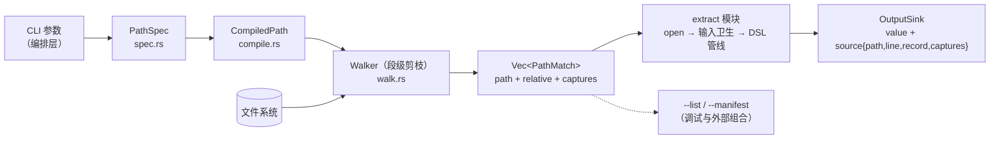

# UniExtract 模块拆分与路径匹配模块设计（v1 提案）

> **状态：设计提案，未实现。** 本文定义目标契约与实施路线，**不修改** v3 权威设计（`.trae/documents/统一信息抽取器-cli-设计.md`）的任何既有条款，也不把本文的参数写成「已落地」。
> 基线仓库版本：`0.2.0`（v3 阶段 0–6 已全部完成，85 项 Rust 测试 + 45 条 sample 冒烟）。
> 本文所有 CLI 参数均标注 **[提案]**，落地前不可作为使用依据。
> 触发场景（用户原话）：`data/` 下很多日志，只想匹配 `data/{%Y-%m-%dT%H:%M:%S}_SRRG/render_service/{\d+}min/hidumper/txt` 下的正则 `NativeHeap pss`。

---

## 0. 为什么必须拆成两个模块

### 0.1 现状（v0.2.0）

```
lib.rs::run
  ├─ cli.validate / Pipeline::compile        （校验前置）
  ├─ discover::discover(cli)  ─────────────►  Vec<Input::{Stdin, File}>
  └─ for input: File::open → InputSource::open → process_source → Pipeline → OutputSink
```

`discover.rs` 把「文件在哪」和「文件里有什么」之间的边界吃掉了一部分：它直接吃 `&Cli`、自己解析 `--exclude`、自己打 warning、自己决定 `Vec<Input>`，而 `lib.rs` 又承担了打开文件、编码探测、session 编排、输出收口。结果是四类问题：

| # | 问题 | 具体表现 |
|---|---|---|
| C1 | **表达力不足** | 路径侧只有 glob（`*`/`?`/`[]`/`**`）、`--fuzzy` 模糊子串、`--exclude` 排除 glob。`\d+`、时间戳形状、枚举、命名捕获都表达不了 |
| C2 | **无法剪枝** | `--fuzzy` 明确是「先全量枚举再过滤」的后置谓词；面对几十万文件的日志树，必须把整棵树走完 |
| C3 | **路径信息丢失** | 目录名里的时间戳、`30min` 这类结构化信息在发现阶段被丢弃，`--with-source` 只能给出 `path` 字符串，下游 `jq` 无法按时间/时长分组 |
| C4 | **边界不清** | 发现层依赖 `Cli`、承担 I/O 与告警，无法独立测试、复用或未来拆 crate；抽取层也无法单独接受「一批已定位且带元数据的文件」 |

实测（`target/ux-search-demo.py`，8 个夹具，4 个严格符合路径，其中 3 个内容命中）：外部正则先筛路径可得精确的 3 条；`--fuzzy hidumper` 得 7 条、glob 得 5 条，都混入 `debug/`、`hidumper/raw/`、`xxmin/`、`junk_SRRG` 干扰。

### 0.2 拆分判据

一个东西该独立成模块，当且仅当它满足三条：① 有**自己的输入语言**（这里是路径模式，不是 DSL）；② 有**自己的错误与资源上界**；③ 输出是**可被下游独立消费的一等数据**（文件清单 + 捕获元数据），而不是控制流副作用。文件发现同时满足这三条。

### 0.3 新增设计原则（沿用 v3 的 P1–P6、I1，不重述）

| 编号 | 原则 | 含义 |
|---|---|---|
| **L1** | **路径模式是编译期产物** | 模式先编译成段匹配器 + 上界；非法模式、未知指令、捕获名冲突、正则非法都在打开第一个文件前报 `Usage(2)`（P5） |
| **L2** | **结构性剪枝** | 能按段排除的目录绝不进入；禁止「全量 walk 再正则过滤」作为默认实现 |
| **L3** | **原始 Path 打开，字符串只用于匹配** | 匹配、排序、捕获一律基于归一化相对路径（`/`）；打开文件永远用遍历得到的原始 `PathBuf`（沿用 v3 §5.3，防注入与编码歧义） |
| **L4** | **零匹配可观测、超限不静默** | 零匹配 = 退出 0 + 一行 stderr（P2）；文件数/深度超限 = 显式错误，绝不悄悄截断 |
| **L5** | **跨平台同一 spec 同一语义** | 路径分隔符、大小写、非法字符、时间格式在编译期统一处理；不允许「Linux 能跑、Windows 静默零匹配」 |

---

## 1. 目标与非目标

### 1.1 目标

| # | 目标 | 可验收的观测点 |
|---|---|---|
| G1 | 两个模块有稳定接口，可独立单测/复用 | `locate` 的全部核心逻辑不依赖 `Cli`；`extract` 可接受 `Vec<PathMatch>` 而无需知道模式语法 |
| G2 | 路径模式能表达时间戳、数字、枚举、glob、正则、命名捕获、可选层级 | 用户场景可被一条 spec 精确表达，且不靠外部脚本 |
| G3 | 遍历期按段剪枝 | 与全量 walk 对比：只读应当进入的目录（可用临时目录 + 目录访问计数断言） |
| G4 | 捕获片段作为一等元数据进入结果流 | `--with-source` 输出 `source.captures`；可按 `mins` 过滤/分组 |
| G5 | 保持 v3 全部契约 | 不传新参数时，45 条 sample 冒烟 + 85 项 Rust 测试逐字节不变 |

### 1.2 非目标（明确不做，避免范围蔓延）

- **不做内容索引 / 全文检索**：内容匹配仍由 extract 的 `re()` 阶段负责；本模块只定位文件。
- **不做远程/对象存储**：只本地文件系统；但 `Walker` 以 trait 抽象，未来可接 S3 清单。
- **不做 watch / 增量 / 缓存**：每次调用都是一次完整、确定的枚举（P1）。
- **不做并行遍历**：文件处理永远串行（v3 P1）。
- **不把路径模式做成通用语言**：没有变量、条件、函数、嵌套量词组合；`**` 最多一个。
- **不改抽取 DSL 语义**：`jq`/`xpath`/`re`/`split`/`slurp`、TypeSet 静态上界、`I1`（`Node` 不跨记录/跨文档）全部保持。

---

## 2. 总体架构



### 2.1 模块边界

| 模块 | 输入 | 输出 | 不负责 |
|---|---|---|---|
| **`locate`（路径匹配）** | `PathSpec` 文本 + `LocateOptions`（base、忽略表、上界、排序） | `Vec<PathMatch>`（原始 `PathBuf`、归一化相对路径、命名捕获） | 打开文件、判定编码、抽取内容、输出格式 |
| **`extract`（内容抽取）** | `PathMatch` / 显式路径 / stdin 的字节流 | `Item` 流 → `OutputSink` | 文件系统遍历、路径模式解析、目录剪枝 |
| **`app`（编排层）** | `Cli` | 退出码 | 只包含「编译 → 定位 → 逐文件抽取 → 收口」的胶水，不含业务规则 |

### 2.2 目录结构（目标态）

```
src/
├─ locate/
│  ├─ mod.rs        # pub API：compile / locate / PathMatch / 错误类型
│  ├─ spec.rs       # PathSpec 词法：段、片段、占位、转义（pest 或手写扫描）
│  ├─ compile.rs    # 片段 → SegmentMatcher；静态校验；生成剪枝提示
│  ├─ walk.rs       # 段级遍历、剪枝、排序、去重、资源上界
│  ├─ capture.rs    # 捕获值：文本 / 整数 / 时间戳；转 JsonValue
│  └─ filter.rs     # 谓词链：默认忽略 → exclude → fuzzy → 额外正则
├─ extract/
│  ├─ mod.rs        # 现有 engine/input/source/stage/output/dsl/model/types 迁入
│  └─ ...
├─ cli.rs
└─ app.rs           # 原 lib.rs::run 拆出的编排层（lib.rs 只做 re-export）
```

> **迁移策略**：不一次性搬平铺模块。L1–L2 先新增 `locate/` 并让它产出 `Vec<PathMatch>`；L3 把 `discover.rs` 降级为「无 spec 时的兼容适配器」（产出 `PathMatch { captures: empty }`）；L4 之后再物理移动 `extract/*`。这样每一步都有可逆的回归基线。

---

## 3. 公共接口（Rust 签名草案，[提案]）

```rust
// locate/mod.rs —— 不依赖 Cli，可独立单测
pub struct CompileOptions {
    pub allow_glob_star_star: bool,
    pub max_segments: usize,      // 默认 64
    pub max_captures: usize,      // 默认 32
    pub strict_time: bool,        // 默认 true：校验真实年月日时分秒
}

pub struct CompiledPath {
    segments: Vec<SegmentMatcher>,
    literal_prefix: usize,        // 连续字面段数，供遍历期直接 cd
    capture_names: Vec<String>,   // 确定性顺序
    has_star_star: bool,
}

pub struct LocateOptions {
    pub base: PathBuf,                       // 内部推导的遍历起点（cwd），不是用户参数
    pub excludes: Vec<glob::Pattern>,
    pub fuzzy: Option<String>,
    pub default_ignore: bool,
    pub max_depth: usize,         // 默认 64
    pub max_files: u64,           // 0 = 不限；超限是错误
    pub sort: SortKey,            // Path | Time(name) | Num(name)
}

pub struct PathMatch {
    pub path: PathBuf,                       // 原始路径，打开文件只用它（L3）
    pub relative: String,                    // 归一化 `/` 相对路径，匹配/排序/去重基准
    pub captures: BTreeMap<String, Capture>, // BTreeMap 保证键序确定（P1）
}

pub enum Capture {
    Text(String),
    Int(i64),                                // 溢出则降级为 Text，不 panic
    Time { raw: String, ymd_hms: [u32; 6] }, // 不猜时区，见 §4.4
}

pub fn compile(spec: &str, opts: &CompileOptions) -> Result<CompiledPath, AppError>;
pub fn locate(
    compiled: &CompiledPath,
    opts: &LocateOptions,
    stderr: &mut dyn Write,
) -> Result<Vec<PathMatch>, AppError>;
```

`extract` 侧只增加一项：`Origin` 增加 `captures: Option<Arc<BTreeMap<String, JsonValue>>>`，由编排层在构造 `Origin` 时注入。它是纯 `JsonValue`/`String`，**符合 I1**（跨记录/跨文件容器不持有 `Node`）。`source_json()` 相应多输出一个 `captures` 字段（仅在非空时）。

---

## 4. 路径模式语言 PathSpec（核心设计）

### 4.1 关键判据：段内是「片段序列」，不是单一类型

用户给的两段都不是纯占位：

- `{%Y-%m-%dT%H:%M:%S}_SRRG` = 时间占位 **+ 字面后缀**
- `{\d+}min` = 正则占位 **+ 字面后缀**

因此**不能**「按段判定 glob / regex」，必须把每段切成若干片段（literal / placeholder）再串接匹配。原型（`target/pathmatch-proto.py`）已验证这一文法能精确表达该场景：8 个夹具中恰好 4 个路径匹配、3 个内容命中，与手写外部正则完全一致。

### 4.2 词法

| 概念 | 规则 |
|---|---|
| **段（segment）** | 以 `/` 分隔；`{}` 内部的 `/` 不分段；空段（`//`）非法 → `Usage(2)` |
| **片段（fragment）** | 段内由 `字面文本` 与 `{占位}` 交替组成；`\{`、`\}`、`\\` 为转义 |
| **占位** | `{name:body}` 命名，或 `{body}` 简写（自动命名 `cap1`、`cap2`…） |
| **`**`** | **只能独占整段**，表示 0..N 层任意目录；全 spec 最多一个；段内出现 `a**b` → `Usage(2)` |
| **base** | spec 的第一段若为纯字面且指向已存在目录，视为相对 base 的锚；不引入独立的 `--base` 参数（避免两套基准），但允许 `--base` 覆盖 **[提案，v2]** |
| **锚定** | 整条 spec **全匹配**归一化相对路径（`^...$`），不做子串匹配；末尾必须是文件段 |

> **「目录模式」歧义必须显式化**：用户写的 `.../hidumper/txt` 以目录结尾。规定：末尾为目录时**不自动追加** `**`（那会静默改变语义，违反 P2），而是要求写成 `.../txt/{file:*.txt}` 或 `.../txt/**`。编译期若末段是纯字面且不存在的目录名无法判定，按「文件段」处理；`--list` 可用来核对展开意图。用户场景的正式写法见 §4.7。

### 4.3 占位体：显式前缀优先，简写向后兼容

| 写法 | 含义 | 编译产物 |
|---|---|---|
| `{name:re:\d+}` | 正则片段 | `(?P<name>\d+)`，锚定在段内片段位置 |
| `{name:glob:*.txt}` | glob 片段 | `*`→`[^/]*`、`?`→`[^/]`，`[...]` 交给 `glob` crate 语义 |
| `{name:time:%Y-%m-%dT%H-%M-%S}` | 时间片段 | 形状正则 + 解析校验（§4.4） |
| `{name:lit:foo}` | 强制字面 | 直接 `re.escape` |
| `{\d+}` | 简写 → `re:` | 自动名 `capN` |
| `{%Y-%m-%d}` | 简写 → `time:` | 自动名 `capN` |
| `{*.txt}` | 简写 → `glob:` | 自动名 `capN` |

**简写判定表（唯一合法顺序）**：`body` 以 `%` 开头 → `time`；含 `*` 或 `?` 且不含 `\` → `glob`；其余 → `re`。正式用法一律推荐显式前缀，避免 `\d+` 与 `*.txt` 这类启发式歧义；简写只作为「用户原始写法可原样粘贴」的兼容层。所有正则片段用 `regex::Regex` 编译，禁用 lookaround/回溯引用（crate 本身不支持，P2 明确报错而不是静默降级）。

### 4.4 时间占位

- **支持指令集（v1 最小集）**：`%Y %m %d %H %M %S`，以及字面 `-`、`T`、`_`、`.`。未知指令 → `Usage(2)` 并列出支持集。
- **形状正则**：`%Y→\d{4}`，其余→`\d{2}`，字面字符 `re.escape`。
- **语义校验**：`strict_time=true`（默认）时再解析年月日时分秒（闰年、2 月 30 日、25 点等不匹配）；`false` 时只校验形状。**不猜时区、不换算本地时间**（P1 确定性）：`Capture::Time` 只保存原始串与拆分后的字段，是否提供 epoch 留到 L3 再评估依赖（优先零新增依赖，手写闰年校验即可）。
- **禁止 `:`** **[L5]**：Windows 目录名不能含冒号。格式串里出现 `:` 直接 `Usage(2)`，文案提示改用 `%H-%M-%S`；Linux 采集来的带冒号目录名可用 `{ts:re:\d{4}-\d{2}-\d{2}T\d{2}:\d{2}:\d{2}}` 显式正则绕过，但捕获值降级为 `Text`。这样同一 spec 在两端行为一致，不会「Windows 静默零匹配」。
- 时间捕获在 JSON 里输出两个键：`<name>`（原始串）与 `<name>_fields`（数组 `[Y,m,d,H,M,S]`），避免引入时间戳类型歧义。

### 4.5 编译流程与静态校验（P5）

```
spec 文本
 → ① 分段（尊重 {} 内不切分、转义）
 → ② 每段切片为片段序列
 → ③ 片段分类（显式前缀 / 简写判定表）→ 生成 SegmentMatcher
 → ④ 静态校验：
      捕获名唯一且合法（[A-Za-z_][A-Za-z0-9_]*）
      正则可编译、时间指令合法且无 ':'、glob 合法
      ** 最多一个且独占整段
      段数 ≤ 64、捕获数 ≤ 32、无空段、无 '..' / 绝对路径 / 驱动器前缀
      末段为文件段（显式 glob/regex/字面文件名），否则 Usage(2)
 → ⑤ 生成 literal_prefix（连续纯字面段数）与 capture_names
 → CompiledPath
```

所有错误带**段号 + 片段偏移**，例如 `path spec segment 4: unknown time directive %q (supported: %Y %m %d %H %M %S)`。任何编译错误都发生在打开第一个文件之前（P5），退出 2。

### 4.6 用户场景：原始写法 → 正式 spec → 展开

原始写法（概念模板，Windows 不可落盘）：

```
data/{%Y-%m-%dT%H:%M:%S}_SRRG/render_service/{\d+}min/hidumper/txt
```

正式 spec（命名捕获 + 时间连字符 + 显式文件段）：

```
data/{ts:time:%Y-%m-%dT%H-%M-%S}_SRRG/render_service/{mins:re:\d+}min/hidumper/txt/{file:glob:*.txt}
```

原型编译出的锚定正则与捕获名（正则为便于阅读折行展示，实际是单行）：

```text
segments : ['data', '{ts:...}_SRRG', 'render_service', '{mins:...}min', 'hidumper', 'txt', '{file:...}']
captures : ['ts', 'mins', 'file']
regex    : ^data/(?P<ts>\d{4}-\d{2}-\d{2}T\d{2}-\d{2}-\d{2})_SRRG
           /render_service/(?P<mins>\d+)min/hidumper/txt/(?P<file>[^/]*\.txt)$
```

目标 CLI（**[提案]，当前不可用**）：

```bash
ux --path-spec 'data/{ts:time:%Y-%m-%dT%H-%M-%S}_SRRG/render_service/{mins:re:\d+}min/hidumper/txt/{file:glob:*.txt}' \
   -f text --with-source \
   -e 're(r"NativeHeap pss:\s*(?<kb>\d+)\s*kB") | jq({kb})'
```

期望输出（示意，`ts_fields`/`source.path` 由解析生成）：

```json
{"source":{"path":"data/2026-11-14T19-45-49_SRRG/render_service/30min/hidumper/txt/dump1.txt","line":2,"record":2,"captures":{"ts":"2026-11-14T19-45-49","ts_fields":[2026,11,14,19,45,49],"mins":30,"file":"dump1.txt"}},"value":{"kb":"12345"}}
```

> 当前 v0.2.0 的等价做法：外部正则先筛路径，再把显式文件列表喂给 `ux`（实测命令与结果见工作日志 / `sample/CASES.md` 未覆盖此场景）。本文的目标就是让上面这一条命令取代它。

### 4.7 明确不做的语法

嵌套量词组合、`{}` 嵌套、反向引用、条件片段、路径变量替换到输出路径、正则标志位内联（`( ?i )` 之类）、跨段的捕获引用。需要这些时用两段式（`--list` 导出清单 → 外部处理 → `--manifest` 回灌）解决，不把复杂度塞进模式语言。

---

## 5. 匹配引擎

### 5.1 段级剪枝（L2 的核心）

不使用 `walkdir` 全量遍历。编译产物是**按段对齐**的匹配器序列，遍历按深度推进：

```
depth 0  : base（literal_prefix 段可直接拼接成起始目录，减少 read_dir 次数）
depth k  : read_dir(当前目录)
           for entry:
             if 目录：默认忽略表 → 跳过
                      段 k 的 SegmentMatcher 匹配 entry.file_name()? 不匹配 → 剪枝（不进入）
                      匹配 → 携带该段捕获继续 depth k+1
             if 文件：仅当 k == 最后一段 且匹配 → 收集；否则忽略
** 段    : 允许 0..N 层，深度受 max_depth 限制；每层都跑同一谓词，捕获按最后一次命中取值
```

- 纯字面段用 `==` 比较，O(1)；混合段才调用 `Regex::is_match`；`glob` 段用 `glob::Pattern::matches`（限定单段名，不含 `/`）。
- 目录名与段匹配采用 **OS 原生大小写语义**（Linux 区分、Windows 不区分），但排序与输出恒用归一化字符串 → 文档必须写明「大小写行为随平台」，这是 L5 允许的显式差异。
- symlink 不跟随（沿用 v3 §5.3）；目录参数本身是 symlink 时允许进入一次。

### 5.2 谓词优先级（组合歧义必须定死）

从先到后，**前者一旦拒绝就不再评估后者**：

1. 默认忽略目录表（`.git` / `target` / `node_modules` / …，`--no-default-ignore` 关闭）
2. 段匹配（结构性 include，本模块主逻辑）
3. `--exclude GLOB`（用户排除，匹配归一化相对路径）
4. `--fuzzy QUERY`（兼容 v3 的后置模糊过滤，仍不做剪枝）
5. `--path-regex REGEX` **[提案，可选]**：对归一化相对路径的额外正则 include（不带捕获，给「不想写 PathSpec」的用户）

即 **exclude 永远优先于 include**，与 v3 `--exclude` 的既有语义一致。

### 5.3 排序、去重、稳定性（P1）

- 默认 `sort=path`：按归一化相对路径字典序，与 v3 §5.3 完全一致，保证不传新参数时输出逐字节不变。
- 可选 `sort=time:<capture>` / `sort=num:<capture>`：按捕获值排序，**相同键一律以 `relative` 兜底**，保证稳定。
- 去重：`canonicalize()` 后按绝对路径去重；同一文件被多个 spec/多路径命中只处理一次；`-`（stdin）按参数位置插入，不参与排序（沿用 v3）。
- 多个路径参数时，仍按**命令行参数顺序**展开，每个参数内部排序（v3 契约不破）。

### 5.4 空匹配、错误与资源上界

| 情况 | 行为 |
|---|---|
| 所有 spec 展开为空 | 退出 0 + stderr `ux: no files matched <spec>`（v3 现有 `no input files matched` 保持兼容，新参数用新文案） |
| base 不存在 / 不是目录 | `Runtime(1)`，明确指出 base（不是零匹配，P2） |
| 单个目录 `read_dir` 失败 | warning + 跳过；若因此零文件，追加 `no files matched`；`--strict` 改为终止 |
| 匹配文件数 > `max_files` | `Runtime(1)`「refusing to silently truncate」，不静默截断 |
| 深度 > `max_depth` / 段数 > 64 / 捕获 > 32 | 编译期或遍历期显式错误 |
| 显式传入的不存在文件 | 沿用 v3：打开失败 `Runtime(1)`，不算零匹配 |

`max_files` 限制的是**文件数**，与现有 `--max-results`（限制结果条数）是两个独立维度，文档必须并列说明。

### 5.5 与 v3 `discover` 的兼容与差分

无 `--path-spec` / `--path-regex` 时，编排层走兼容适配器：输出 `PathMatch { captures: {} }`，行为与 v0.2.0 逐字节一致。L2 阶段补一组**差分测试**：对同一棵临时目录树，分别用旧 `discover()` 与新 `locate()`（等价 glob spec）产出文件列表，断言顺序、去重、默认忽略、空匹配 warning 全部一致。

---

## 6. 捕获元数据如何进入抽取结果

1. 编排层把 `PathMatch.captures` 转成 `BTreeMap<String, JsonValue>`（`Text`→string、`Int`→number、`Time`→原始串 + `_fields` 数组），挂到该文件的 `Origin`。
2. `--with-source` 输出新增 `source.captures`；不带 `--with-source` 时**完全不输出**（不改变 stdout 纯净性，P3，也不破既有断言）。
3. `slurp()` 会话跨文件聚合时，每条记录仍携带自己的 `Origin`，因此 captures 可在聚合结果里保留；符合 I1（只有 `JsonValue`，无 `Node` 跨文件）。
4. `-O text` 与 `--with-source` 仍互斥（v3 既有约束），所以按 captures 分组时必须用 `-O jsonl` / `-O json`。
5. **不新增 DSL 阶段**（ADR A21）：v1 不提供 `source()` / `path()` 阶段，避免把路径元数据引入 TypeSet 与类型上界检查；需要「按 `mins` 过滤」时，下游对 `--with-source` 的 JSONL 再跑一次 `ux -e 'jq(select(...))'`，或等 v2 评估 `--path-filter`。

---

## 7. CLI 契约草案（[提案]，全部未实现）

### 7.1 三种形态对比

| 形态 | 做法 | 优点 | 为什么（不）选 |
|---|---|---|---|
| A 子命令 + 管道 | 两个子命令用管道串接 JSONL 清单 | Unix 组合、清单可被外部加工 | 需定义清单 schema；`-` 只能出现一次，stdin 被清单占用；多一次序列化；Windows 转义脆弱 |
| **B 单命令 + 库分层（推荐）** | `ux --path-spec ... -e ...`，编排层进程内调用 locate | 零 IPC、保持 v3 全部契约、`--with-source` 天然带 captures、可渐进落地 | 两个模块仍在同一进程；但库边界清晰，未来可拆 crate |
| C 两个二进制 | `ux-locate` + `ux-extract` | 部署解耦 | 对一个 CLI 产品是过度拆分，用户要记两套参数 |

**推荐 B**；A 的 `--manifest` 作为 v2 可选输入输出保留（调试/与外部工具组合），但不作为 v1 的主路径。库层按 A/C 的边界设计，因此将来真要拆不会重写。

### 7.2 新增参数

```text
ux -e PIPELINE
   [--path-spec SPEC]            [提案] 结构化路径模式，见 §4
   [--path-regex REGEX]          [提案] 归一化相对路径的 include 正则（无捕获）
   [--list]                      [提案] 只输出清单（JSONL: path + captures），不抽取
   [--sort path|time:NAME|num:NAME]   [提案] 默认 path
   [--max-files N]               [提案] 0 = 不限，超限报错
   [--relaxed-time]              [提案] 时间占位只校验形状
   [PATH|GLOB|-]...              # v3 既有，与 --path-spec / --path-regex 互斥
```

互斥矩阵（全部 `Usage(2)`，P5 前置）：

| 组合 | 结果 |
|---|---|
| `--path-spec` + 任意 `PATH` 参数 | 两套发现语义不能并存 |
| `--path-spec` + `--path-regex` | 两种 include 语义不能并存 |
| `--list` + `--with-source` / `-O text` | `--list` 有自己的输出格式 |
| `--sort time:NAME` 但 NAME 不是捕获名 | 编译期报错并列出可用捕获名 |
| `--relaxed-time` 但 spec 无时间占位 | warning 提示忽略（P2 不静默） |
| `--path-spec` 与 `--fuzzy` / `--exclude` | 合法，按 §5.2 优先级组合 |

`--list` 输出（stdout 纯净，P3）：

```json
{"path":"data/.../dump1.txt","relative":"data/.../dump1.txt","captures":{"ts":"...","mins":30,"file":"dump1.txt"}}
```

---

## 8. 错误与退出码矩阵

| 输入 | `exit` | 文案要点 |
|---|:---:|---|
| spec 语法错误（未闭合 `{`、空段、`a**b`、重复捕获名、`..`、绝对路径） | 2 | 段号 + 片段偏移 + 修复建议 |
| 未知时间指令 / 格式串含 `:` / 正则非法 / glob 非法 | 2 | 列出支持集或编译错误原文 |
| `--path-spec` 与 PATH 并存等互斥 | 2 | 指出两个参数名 |
| base 不存在 / 不是目录 | 1 | 指出 base 路径 |
| 单个目录不可读 | 0 + warning | `--strict` 时为 1 |
| 零匹配 | 0 + warning | `no files matched <spec>` |
| 文件数超 `--max-files` | 1 | 明确「拒绝静默截断」 |
| 打开/解析文件失败 | 沿用 v3 | 1（`--strict` 提前终止） |

---

## 9. 跨平台与安全

- **分隔符**：输入 spec 与内部匹配恒用 `/`；Windows 反斜杠在输入时归一化，但**打开的仍是原始 `PathBuf`**（L3）。`source.path` 保持平台原生形态（v0.2.0 实测：显式文件是传入字符串、目录发现是原生反斜杠），`source.captures` 与 `relative` 恒为正斜杠。
- **路径注入**：spec 拒绝 `..`、绝对路径、盘符；匹配结果不用于拼接新路径；不做字符串反推。
- **非法字符**：编译期拒绝 `: * ? " < > |` 出现在**字面片段**中（Windows 保留字），正则/glob 片段里允许 `*` `?` 作为元字符；这一规则跨平台一致（L5）。
- **非 UTF-8 文件名**：默认跳过 + warning（lossy 转换会造成歧义），`--allow-lossy` **[v2]** 再评估；捕获值只对能完整 UTF-8 解码的名字生成。
- **时间**：不猜时区、不读本地时区环境变量（P1）；`ts_fields` 是 wall-clock 拆分，不是 epoch。
- **大小写**：§5.1 已说明；文档需明写「同一 spec 在大小写不敏感文件系统上可能多匹配」，这是 OS 语义而非实现 bug。

---

## 10. 实施计划

| 阶段 | 内容 | 验收标准 |
|---|---|---|
| **L0** | 本设计文档评审、开放问题拍板（§13） | 用户确认语法与 CLI 形态；不改代码 |
| **L1** | `locate/spec.rs` + `compile.rs`：词法、片段分类、静态校验、捕获名表 | 纯函数单测 ≥ 30 条；非法 spec 全为 `Usage(2)` 且不 panic（fuzz 入口 `parse_pathspec`） |
| **L2** | `locate/walk.rs` + `filter.rs` + `capture.rs`：段级剪枝、排序、去重、上界 | 与 v3 `discover()` 差分测试全绿；目录访问计数证明剪枝生效；用户场景 4/8 路径精确匹配 |
| **L3** | 编排接入：`Origin.captures`、`--with-source` 输出、兼容适配器 | 不传新参数时 45 条 sample + 85 项 Rust 测试逐字节不变；`--list` 输出可复现 |
| **L4** | CLI 参数 + 互斥矩阵 + README / v3 文档 / `sample/` 新夹具树 + smoke 用例 | 端到端一条命令跑通 `NativeHeap pss`；CI 全绿；`sample/CASES.md` 由生成器自动同步 |
| **L5** | 性能基准（10 万文件树）、spec fuzz、跨平台 CI（Windows + Linux） | 剪枝 vs 全量 walk 的目录访问数差异可量化；无平台相关静默零匹配 |

每阶段结束跑 `cargo fmt --check` / `clippy --all-targets -- -D warnings` / `cargo test --all-targets` / `cargo build --release` / `python sample/smoke.py` / `python sample/export_cases.py --check`。

---

## 11. 测试矩阵（要点）

| 维度 | 用例 |
|---|---|
| 词法 | `{}` 内 `/` 不分段；`\{` 转义；混合段 `{ts:...}_SRRG`、`{mins:...}min`；空段；未闭合 `{` |
| 占位类型 | 显式 `re:`/`glob:`/`time:`/`lit:` 全排列；三种简写判定；未知前缀报错 |
| 时间 | 闰年、2 月 30 日、25 点、`%H:%M:%S` 被拒、`--relaxed-time` 放宽、Windows 连字符写法 |
| 剪枝 | `debug/`、`raw/`、`xxmin/`、`junk_SRRG/` 四类干扰目录不被读取；`**` 的 0/1/N 层 |
| 排序 | 默认字典序；`time:ts`、`num:mins`；同键兜底稳定；多参数顺序 |
| 契约 | 零匹配、base 不存在、遍历错误、`--max-files` 超限、`--strict`、互斥矩阵 |
| 兼容 | 与旧 glob/fuzzy/exclude 差分；不传新参数输出不变 |
| 端到端 | 用户场景：一条命令得到 3 条 `NativeHeap pss`，每条带 `captures.ts/mins/file` |
| 属性 | 任意 spec 编译要么成功要么 `Usage(2)`，不 panic、不栈溢出；同一树重复运行结果逐字节相同 |

---

## 12. ADR（决策记录）

| 编号 | 决策 | 理由 / 被否方案 |
|---|---|---|
| **A17** | 新建 `locate` 模块，而不是给 `discover.rs` 加一个正则参数 | 路径匹配有自己的输入语言、错误上界与输出数据；塞进 discover 会让 C1–C4 全部保留 |
| **A18** | 段级编译 + 遍历期剪枝，禁止全量 walk 再过滤 | 日志树规模下 C2 是硬伤；且段对齐后纯字面段可 O(1) 直接跳过 |
| **A19** | 显式前缀为主、简写兼容；时间只支持 6 个指令且禁止 `:` | 启发式分类（`\d+` vs `*.txt`）有歧义；冒号在 Windows 非法，统一禁用才能 L5；不引入完整 strftime |
| **A20** | 单命令 + 库分层（B），不做子命令管道（A） | 零 IPC、stdin 契约不被占用、v3 契约不破；库边界仍允许未来拆 crate |
| **A21** | 捕获元数据放 `Origin`，不新增 DSL 阶段 | 避免把路径数据引入 TypeSet 与类型上界；`--with-source` 已是既有的元数据通道 |
| **A22** | 默认严格校验时间、默认按路径字典序、不并行 | P1 确定性 + P2 宁可吵；时间排序与宽松校验必须显式开启 |
| **A23** | 兼容适配器保留无 spec 时的旧行为 | 45 条 sample 断言是回归基线，任何「顺手改一下」都会破坏逐字节契约 |

---

## 13. 已知限制与需要拍板的开放问题

**已知限制（v1 接受）**

- `**` 最多一个且必须独占整段；不支持多层级组合量词。
- 时间占位不带时区、不给 epoch，只给 wall-clock 字段。
- 非 UTF-8 文件名默认跳过；大小写行为随文件系统。
- 不做内容索引、watch、远程存储、并行遍历。
- `--path-regex` 不产生捕获；需要捕获必须写 `--path-spec`。

**开放问题（请确认后进入 L1）**

| # | 问题 | 建议默认值 |
|---|---|---|
| Q1 | 时间占位是否校验真实日期（2 月 30 日）？ | 默认严格，`--relaxed-time` 放宽 |
| Q2 | 末尾目录是否自动补 `/**`？ | **否**，必须显式写文件段（P2 不静默补语义） |
| Q3 | 默认排序是否改成按时间？ | **否**，保持字典序以兼容 v3；`--sort time:ts` 显式开启 |
| Q4 | v1 是否就要 `--manifest` 与子命令形态？ | **否**，留到 v2；v1 只给 `--list` |
| Q5 | 是否允许「简写」判定表（启发式）长期存在？ | 允许，但文档与 `--list` 都展示编译后的显式类型，避免误判 |
| Q6 | 时间解析是否引入 `chrono`？ | **否**，v1 手写 6 字段 + 闰年校验，保持依赖面不变 |

---

## 14. 状态与同步规则

- 本文是 **v1 提案，全部 [提案] 参数均未实现**；当前可用行为以 v3 文档与 `sample/CASES.md` 为准。
- 实施进入 L3 时，才更新 v3 文档的 §4.3 CLI 契约、§5.2 校验矩阵、§5.3 文件发现、§9 ADR（A24 起）与 §0.5 状态表；**不得**把提案条款提前写成 `[已实现]`。
- 每完成一个 L 阶段，按仓库既有规则自行 `git commit` + `git push`，并同步 `CHANGELOG.md`、README 与工作区日志。
